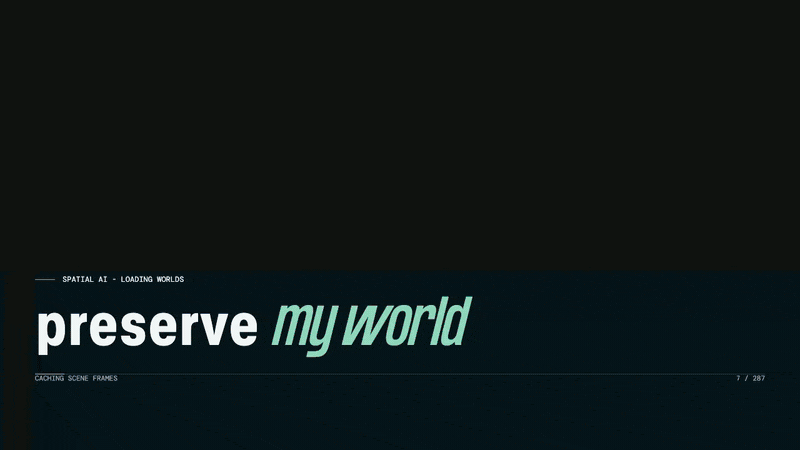
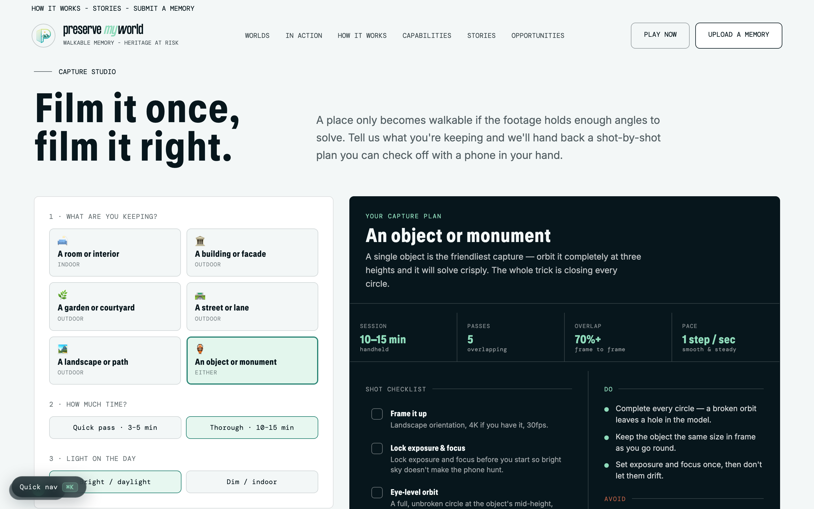
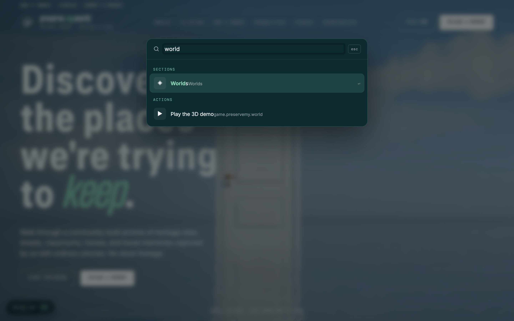
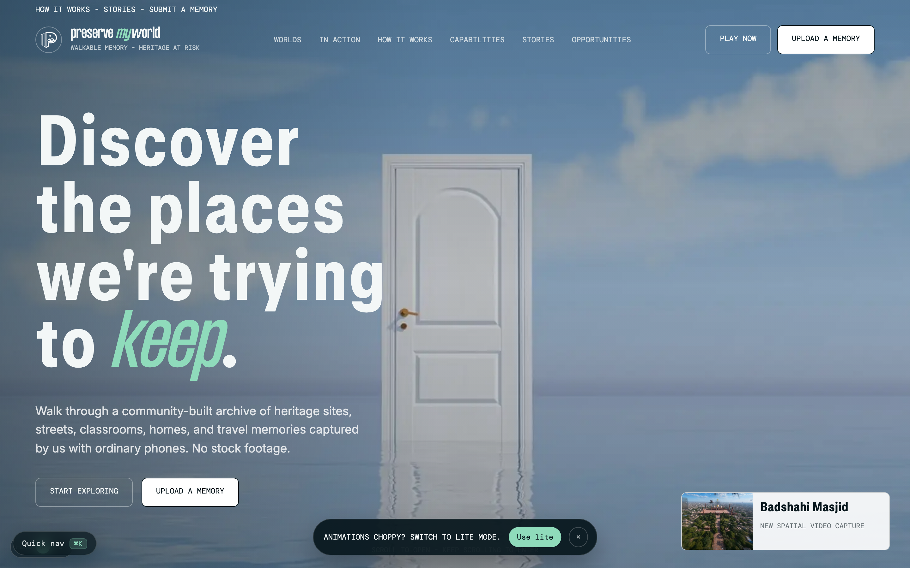
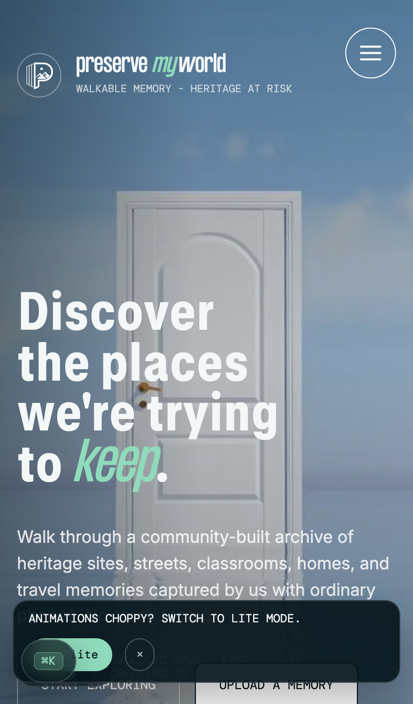
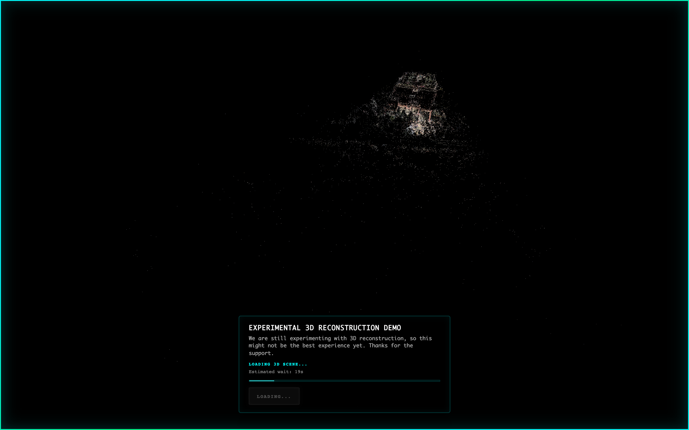

# preservemy.world 🌍🚪

> Walkable memory, heritage at risk. Turn ordinary phone footage into 3D worlds you can wander back into.

**preservemy.world** takes the places people are quietly losing — a family room before a move, a courtyard before repair, a mountain path before the season changes it — and turns everyday video into **walkable 3D memories**. No stock footage, no fancy rig. Just a phone, a place worth keeping, and a door you can open again later.

This repo holds the marketing site (a lovingly hand-built, scroll-animated landing experience), an **in-browser 3D reconstruction demo** that renders real captured scenes as point clouds and Gaussian splats, and — new in this pass — a **Capture Studio planner, a ⌘K command palette, a mobile nav drawer, an A/B hero experiment, and a full test suite**.

<p align="center">
  
</p>

<p align="center"><em>Real capture. Real page. The door actually opens. 🚪✨</em></p>

---

## 🆕 What's new in this release

We didn't just dust the place — we added whole new rooms.

| ✨ New | What it does | Where |
| --- | --- | --- |
| **Capture Studio** | An interactive planner that hands you a tailored, shot-by-shot capture checklist based on *what* you're preserving (room, façade, courtyard, path, or a single object) and *how much time* you have. | `#studio` on the site · `assets/studio/` |
| **⌘K Command Palette** | A keyboard-first launcher (⌘K / Ctrl-K) that fuzzy-jumps between sections, opens the 3D demo, and surfaces key actions — because scrolling a long story shouldn't be the only way around. | `assets/command-palette.js` |
| **Mobile nav drawer** | A proper slide-in navigation for phones and tablets, so the menu no longer plays hide-and-seek on small screens. | `assets/mobile-nav.js` |
| **UI polish layer** | Non-invasive micro-interactions: refined hover/focus states, button feedback, and IntersectionObserver-driven scroll reveals. | `assets/ui-enhance.*` |
| **A11y + perf pass** | Keyboard-visible focus rings, a skip-to-content link, `prefers-reduced-motion` handling for the hero video, and preconnect/font-preload resource hints. | inline in `index.html` |
| **Hero A/B experiment** | An alternate hero treatment (Variant B) that stays completely inert unless you add `?variant=b`. Ship experiments without shipping risk. | `assets/variants/` · [docs](docs/HERO-AB-VARIANT.md) |
| **Discoverability & packaging** | Full favicon/icon set, web app manifest, JSON-LD structured data, `sitemap.xml`, `robots.txt`, and a social share card for rich link previews. | repo root · `assets/icons/` |
| **Automated test suite + CI** | Node unit tests for asset/config/structure invariants and Playwright e2e specs for the landing page, forms, and 3D demo — all wired into GitHub Actions. | `tests/` · `.github/workflows/` |

### The Capture Studio, in action

Tell it what you're keeping; it hands back a plan you can check off with a phone in your hand — session length, number of passes, overlap, pace, a shot checklist, and the do's and don'ts that actually make a scene *solve*.

<p align="center">
  
</p>

### ⌘K to go anywhere

<p align="center">
  
</p>

---

## 🧭 A/B hero experiment

The site ships two hero treatments. **Variant A** (default) is the door-opening kinetic hero you see above. **Variant B** is an alternate framing that reuses the existing form wiring and only wakes up when asked:

```
https://preservemy.world/?variant=b
```

No query string, no Variant B — it's fully inert by default, so there's zero risk to the production experience. The full write-up lives in [`docs/HERO-AB-VARIANT.md`](docs/HERO-AB-VARIANT.md).

---

## 🖼️ A look around

| Desktop hero | On your phone | The 3D demo |
| --- | --- | --- |
|  |  |  |

---

## 🌱 Core features

- **Walk, don't scroll** — every world is a timestamped place you can move through, not a flat photo.
- **Captured by real people, on real phones** — no stock footage anywhere on the site.
- **Fully responsive** — layout, type, and media adapt gracefully from a 4K monitor down to a pocket screen, now with a dedicated mobile nav drawer.
- **Fast & considerate** — reduced-motion support, lite mode for weak connections, lazily-loaded video posters, and resource hints to cut layout shift.
- **Keyboard-friendly** — visible focus rings, a skip link, and ⌘K to jump anywhere.
- **Social-ready** — Open Graph, Twitter cards, JSON-LD, and a share image so links look the part.
- **Installable demo** — the reconstruction viewer ships a web manifest and service worker, so it can live on a home screen.

---

## 🚀 Run it locally

No build step, no toolchain, no drama. It's static — you just need to serve the folder over HTTP (opening `index.html` via `file://` won't load the modules or fonts correctly).

```bash
# 1. Grab the code
git clone https://github.com/waleedsworld/preservemy-world.git
cd preservemy-world

# 2. Serve it with anything that speaks HTTP. Python is already on most machines:
python3 -m http.server 5803

# 3. Open the door
#    Landing page → http://127.0.0.1:5803/
#    3D demo      → http://127.0.0.1:5803/demo-game/   (see note below)
```

Prefer Node? `npx serve .` works just as well. Prefer Docker? There's a `Dockerfile` that serves the site on port 8080 with nginx:

```bash
docker build -t preservemy-world .
docker run --rm -p 8080:8080 preservemy-world
# → http://127.0.0.1:8080/
```

> 💡 **The 3D demo needs cross-origin isolation** (COOP/COEP headers) for Spark's `SharedArrayBuffer`. A plain `python3 -m http.server` won't set those — so the demo ships its own hardened dev server: `python3 demo-game/serve.py` sends the right headers. On a slow or offline connection the viewer shows a friendly "still loading / could not load" message instead of the world — that's expected, not a bug.

---

## 🧪 Tests

The suite is split into fast Node unit checks and Playwright end-to-end specs.

```bash
npm install                # dev-only: @playwright/test
npm run test:unit          # asset / config / structure invariants (node --test)
npm run test:e2e:install   # one-time: fetch the Chromium browser
npm run test:e2e           # landing page, forms, and 3D demo e2e
npm test                   # unit + e2e together
```

Everything runs on push via `.github/workflows/tests.yml`. Green ticks or it didn't happen.

---

## 🗂️ Project layout

```
preservemy-world/
├── index.html              # the landing experience (all core CSS/JS inline)
├── assets/
│   ├── studio/             # 🆕 Capture Studio planner (css + js)
│   ├── command-palette.js  # 🆕 ⌘K quick-nav
│   ├── mobile-nav.js       # 🆕 slide-in mobile navigation
│   ├── ui-enhance.*        # 🆕 micro-interactions + scroll reveals
│   ├── variants/           # 🆕 hero A/B experiment (inert unless ?variant=b)
│   ├── icons/              # 🆕 favicon / PWA icon set
│   ├── fonts/  places/  worlds/  social/   # type, hero video, world clips, posters
│   └── ...
├── demo-game/              # in-browser 3D reconstruction viewer (PWA)
│   ├── index.html          # three.js + Spark scene + guided trajectory
│   └── serve.py            # 🆕 hardened dev server w/ COOP/COEP + CLI flags
├── tests/                  # 🆕 unit + Playwright e2e
├── docs/                   # media + A/B experiment notes
├── site.webmanifest · sitemap.xml · robots.txt · favicon.ico   # 🆕 packaging
└── Dockerfile              # nginx static-serve for deployment
```

---

## 🧰 Built with

- Hand-written HTML/CSS/JS — no framework, core styles and logic inline for a single-request feel
- [Lenis](https://lenis.darkroom.engineering/) for buttery smooth scrolling
- [SplitType](https://github.com/lukePeavey/SplitType) for line-by-line kinetic typography
- [three.js](https://threejs.org/) + [Spark](https://sparkjs.dev/) for the Gaussian-splat 3D demo
- [Playwright](https://playwright.dev/) + Node's built-in test runner for CI
- Custom typefaces (GT Standard, FS, Inter, DM Mono) for that editorial feel

---

## 🌐 Live

**[preservemy.world](https://preservemy.world)** — the door's already open. The 3D archive lives at **[game.preservemy.world](https://game.preservemy.world)**.

## 📄 License & credits

Original design, copy, and code for preservemy.world. The captured worlds, footage, and heritage sites belong to the people and places that shared them — please treat them with the care they deserve.

---

<p align="center"><em>Preserve the places the world might forget. 🚪</em></p>
